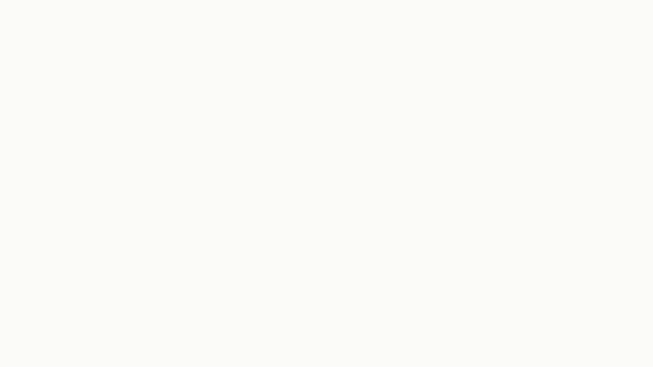
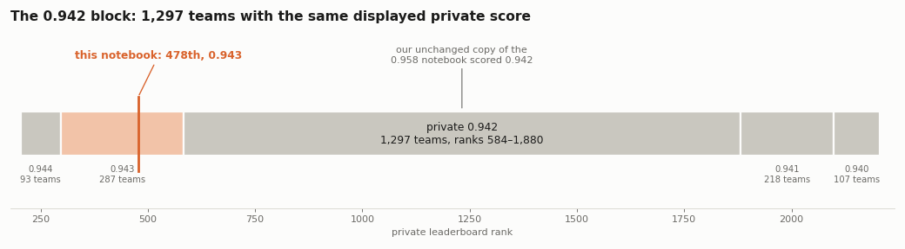
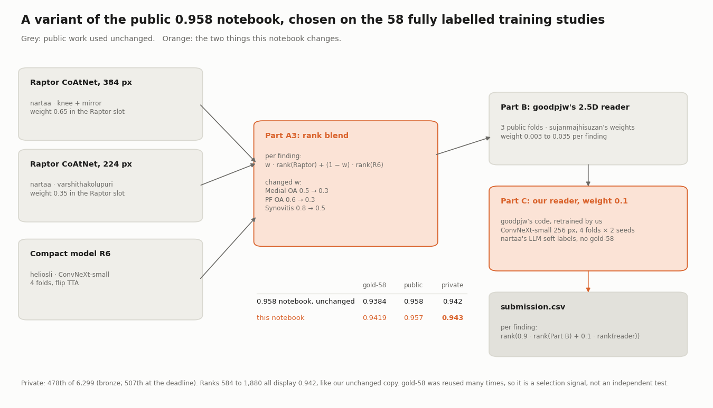
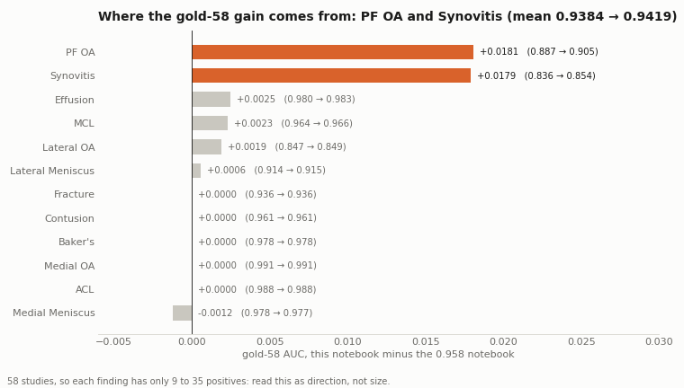
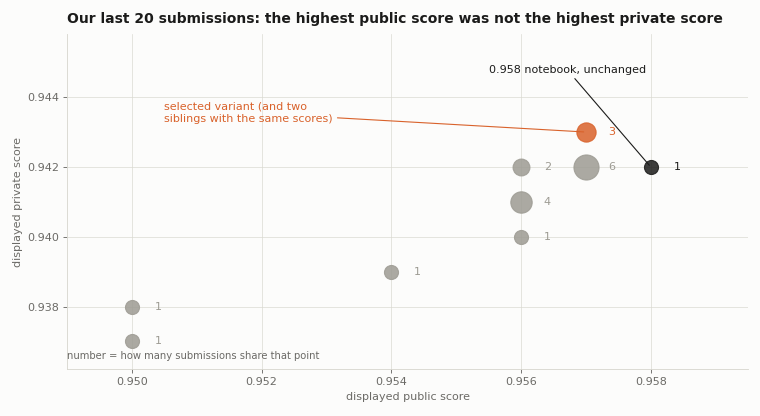

# Kaggle RSNA Knee Abnormality Detection — 478th / 6,299（銅牌）

截止時有 1,638 隊的公開分數顯示 0.958；本專案提交的變體都顯示 0.957，其中幾個在 58 筆完整標註的訓練資料上分數比較高，所以本專案改用這 58 筆、把整條推論流程重跑一遍來挑版本；最後的 Private 分數比原樣複製版高 0.001，在 6,299 隊中排第 478 名，拿到銅牌。

> **TL;DR** — On RSNA Knee Abnormality Detection (12 findings, macro AUC), 1,638 teams showed public 0.958 at the deadline and every variant of that public notebook we submitted showed 0.957, so we selected on the 58 fully labelled training studies ("gold-58"), running the full deployed chain on their DICOMs. Two changes — per-finding blend weights and our own retrained reader at weight 0.1 — gave private 0.943 vs 0.942 for the unchanged notebook: 478th of 6,299 on the final leaderboard (bronze).

*34 秒解說動畫（以 [Manim](https://www.manim.community/) 製作，原始檔 [`scripts/explainer_video.py`](scripts/explainer_video.py)）。*

## 重點結果

- **公開分數幾乎相同**：截止時有 1,638 隊的公開分數顯示 0.958（[`evidence/private_leaderboard_blocks.txt`](evidence/private_leaderboard_blocks.txt)）；本專案提交的變體公開分數都顯示 0.957（[`evidence/submissions_public_private.json`](evidence/submissions_public_private.json)）。
- **改用 gold-58 挑版本**：在 58 筆完整標註的訓練資料上跑完整推論流程，原版 0.9384、本專案選的版本 0.9419（[`evidence/gold58_strict_chain.txt`](evidence/gold58_strict_chain.txt)）。
- **結果**：Private 0.943，原樣複製的原版 0.942。最終排行榜上第 584 到 1,880 名（1,297 隊）都顯示 0.942，本專案排第 478 名（[`evidence/private_leaderboard_blocks.txt`](evidence/private_leaderboard_blocks.txt)）。

## 改了什麼（只有兩處）

1. **第三階段融合的權重**：Medial OA 0.5 → 0.3、PF OA 0.6 → 0.3、Synovitis 0.8 → 0.5，其餘不變。
2. **加入重新訓練的 reader，權重 0.1**：沿用 goodpjw 公開的 2.5D reader 程式，改成 ConvNeXt-small、256 px、4 折 × 2 個 seed，用 nartaa 公開的 LLM 軟標籤訓練；gold-58 從不參與訓練。

gold-58 上的進步大部分（約 86%）來自 PF OA 和 Synovitis（[`evidence/gold58_per_finding.json`](evidence/gold58_per_finding.json)）：

## 公開分數與 Private 分數

本專案最後 20 次提交裡，公開分數最高的那一次（原樣複製版，0.958），Private 反而輸給三個公開 0.957 的變體：

## 限制

- **gold-58 不是獨立驗證集**：本專案和上游作者都反覆用過這 58 筆來挑選，0.0035 的差距只能當押注方向，不能當成 Private 會進步多少的估計。
- **Private 只多 0.001**：排行榜顯示到小數點後三位，差距很小；這次方向對了，不代表同樣做法每次都會贏。
- **大部分成果來自公開作品**：模型、融合程式和大部分權重都是其他參賽者公開的成果，本專案的貢獻是挑選方法、兩處修改和重新訓練的 reader。

## 沒有幫助的方向

用 Raptor 預測做知識蒸餾的 reader、提早停止加 SWA、高解析度 reader、EfficientNetV2 reader、凍結的 OrthoFoundation 特徵、逐項 reader 權重。幾個方向單獨驗證有進步，但在測過的設定下融合後沒有可信的增益。

## 公開內容

| 內容 | 連結 |
|---|---|
| Solution（掛在排行榜第 478 名） | https://www.kaggle.com/competitions/rsna-knee-abnormality-detection/writeups/478th-bronze-a-variant-of-the-public-0-958-note |
| 得分 notebook（程式與得分版逐格相同） | https://www.kaggle.com/code/yukuo14/rsna-knee-478th-bronze-variant-of-0-958-notebook |
| reader 訓練程式與標籤重建 | https://www.kaggle.com/datasets/yukuo14/rsna-knee-reader-training-code |
| reader 權重（8 個 checkpoint） | https://www.kaggle.com/datasets/yukuo14/rsna-knee-gp-own8 |
| 討論文 | https://www.kaggle.com/competitions/rsna-knee-abnormality-detection/discussion/751949 |

`scripts/` 是產生本頁圖片與動畫的程式（matplotlib、Manim），數字直接寫在程式裡，來源見上面各證據檔。

## 致謝

本專案建立在這些公開成果上：goodpjw（0.958 notebook 與 2.5D reader）、sujanmajhisuzan（reader 改進與 reader 融合權重）、heliosli（R6 小模型、翻轉 TTA、融合程式與原始逐項權重）、nartaa（Raptor CoAtNet 權重與 LLM 軟標籤）、Dread Development（Raptor 做法）、varshithakolupuri（把 224 權重與鏡像帶進融合）、rostigor（R6 版本化副本）、rabari9999（reader 程式來源 notebook），以及 stevenleehans、Pilkwang Kim、riadmohamed42（nartaa 標籤背後的報告標籤表）。Raptor 權重使用了 OAI 資料，完整的 OAI 致謝聲明見 [notebook](https://www.kaggle.com/code/yukuo14/rsna-knee-478th-bronze-variant-of-0-958-notebook)。

## 授權

`scripts/` 以 MIT 授權釋出（見 [`LICENSE`](LICENSE)）。圖片與文字可自由引用並註明出處。比賽資料與其他資料集依各自的條款。
